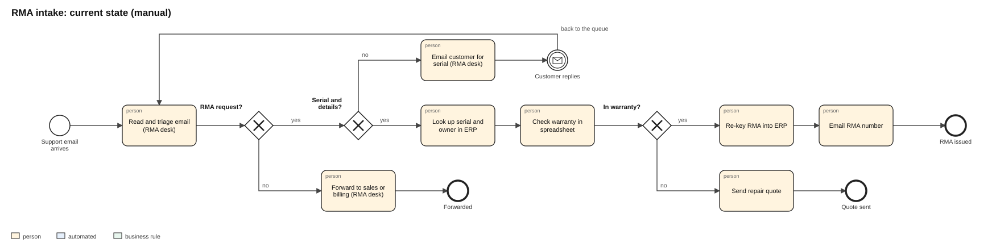

# 1. Process discovery: RMA intake, current state

*Fictional company and synthetic data. This is the document a business systems analyst would produce after discovery sessions with the RMA desk, support and engineering.*

## Scope

Customers email the support inbox when a server fails under warranty. The RMA (return merchandise authorization) desk reads each email, works out what failed and on which unit, checks the warranty, enters the RMA in the ERP and emails the customer an RMA number. In scope: inbox to RMA number. Out of scope: logistics, repair and credit.

## Current state

BPMN 2.0 source: [`bpmn/current_state.bpmn`](../bpmn/current_state.bpmn) (opens in Camunda Modeler or bpmn.io).

| Step | Who | System | Hands-on time (from interviews) |
|---|---|---|---|
| Read and triage the email | RMA desk | Shared inbox | ~10 min |
| Email the customer for a missing serial or details, then wait | RMA desk | Shared inbox | ~5 min, plus the customer's reply time |
| Look up the serial and owner | RMA desk | ERP | part of entry |
| Check warranty against ship date | RMA desk | Spreadsheet export from ERP | part of entry |
| Create the RMA and email the number | RMA desk | ERP, inbox | ~15 min |
| Escalate smoke, burning or sparks to engineering | RMA desk | Phone | whenever it is noticed |

## Baseline, July to September 2026 (data/baseline_log.csv)

| Measure | Baseline |
|---|---|
| Requests | 480: 410 RMA requests, 70 that were not RMAs (quotes, orders, invoices, BIOS questions), 124 in French |
| Time from email to RMA number | median **8.9 h**, 90th percentile **33.4 h** |
| Time until someone first reads it | median 4.7 h |
| RMA requests that needed a follow-up email for missing details | **21.7%** |
| RMAs entered with the wrong failure category | **8.6%** |
| Warranty decisions made wrong | **4.4%** |
| Safety emails (smoke, burning, sparks): time until a human saw them | median **3.5 h**, worst **25.9 h** |

## Pain points

1. **Safety issues wait in the same queue as everything else.** The worst case sat for a day.
2. **One in five requests stalls for missing information,** usually the serial number, and the follow-up email itself waits for triage.
3. **Re-keying.** The desk copies serials, models and symptoms from email into the ERP by hand, and checks warranty in a spreadsheet that is exported weekly.
4. **Wrong categories** send units to the wrong repair bench and distort failure reporting to engineering.
5. **Non-RMA emails** (quotes, invoices, order status) land in the RMA inbox and wait for triage before being forwarded.
6. **French emails** go to the two bilingual analysts, which creates a second queue.

## Data sources

| Source | Owner | Used for | Access needed |
|---|---|---|---|
| Support inbox | Support | the request text, sender domain | read; send replies |
| Installed base (ERP) | Operations | serial, model, owner, ship date, warranty term | read only |
| RMA module (ERP) | RMA desk | create RMA drafts | create draft; approval stays with a person |
| Historical tickets with final category | RMA desk | training and evaluation labels | read only |

## Opportunities found

| Opportunity | Effort | Benefit | Data sensitivity |
|---|---|---|---|
| Flag safety language instantly and page engineering | Low | High: removes the worst risk | Low |
| Read the email, extract serials and classify the failure (EN/FR) | Medium | High: removes triage and re-keying | Medium: customer emails |
| Check owner and warranty from the ERP automatically | Low | Medium: removes the 4.4% warranty errors | Low (read-only lookup) |
| Draft the missing-serial reply in the customer's language immediately | Low | Medium: starts the customer's clock hours earlier | Low |
| Route non-RMA emails to sales or billing | Low | Low to medium | Low |
| Auto-approve RMAs with no human | Medium | Medium | **Not recommended**: approval stays with the desk (one click) |
