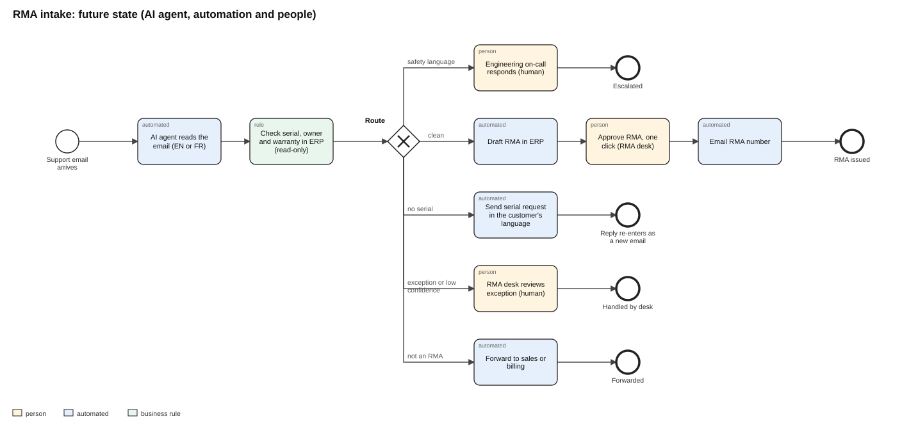

# 2. Future state and requirements



BPMN 2.0 source: [`bpmn/future_state.bpmn`](../bpmn/future_state.bpmn). Orange tasks are done by people, blue are automated, green is a business-rule check.

**Where people stay in the loop:** every RMA is still approved by the desk (one click instead of 25 minutes of re-keying). Safety, exceptions and anything the agent is unsure of go to a person. A random 10% of drafted RMAs are re-checked each month to catch drift.

## User stories and acceptance criteria

**US-1. Safety first.** As the on-call engineer, I want any email describing smoke, burning or sparks escalated to me immediately, so a hazard never waits in the queue.
```gherkin
Given an inbound email that mentions smoke, burning, a burning smell or sparks, in English or French
When the agent processes it
Then it is routed to SAFETY_ESCALATION before any other check
And no RMA is drafted from it automatically
```

**US-2. Draft clean RMAs.** As an RMA analyst, I want clear, in-warranty requests turned into RMA drafts, so I approve instead of re-keying.
```gherkin
Given an email classified as an RMA request with confidence of at least 0.80
And every serial in it exists in the installed base, is owned by the sender's company and is in warranty
And the failure category confidence meets the release threshold
When the agent processes it
Then an RMA draft is created with serials, models, failure category and the original email attached
And it waits for one-click approval by the RMA desk
```

**US-3. Ask for the serial right away.** As a customer, I want to be asked for my serial number immediately and in my language, so my RMA isn't delayed by a day.
```gherkin
Given an RMA request with no serial number
When the agent processes it
Then a reply is sent in the language of the email (English or French) asking for the serial and where to find it
And the customer's reply re-enters the flow as a new email
```

**US-4. Hand off what the agent shouldn't decide.** As the RMA desk lead, I want exceptions routed to a person with the reason, so nothing is decided on a guess.
```gherkin
Given a serial that is not in the installed base, or registered to another customer,
   or a unit out of warranty, or a failure category below the confidence threshold,
   or uncertainty whether the email is an RMA request at all
When the agent processes it
Then it is routed to HUMAN_REVIEW with the specific reason shown to the analyst
```

**US-5. Get non-RMA mail to the right team.** As a sales or billing coordinator, I want quotes, orders and invoice questions forwarded to me, so they don't wait in the RMA queue.
```gherkin
Given an email the intent model scores as an RMA request with probability below 0.20
When the agent processes it
Then it is forwarded to sales or billing and no RMA is created
```

**US-6. Measure it.** As the product owner, I want the same measures as the baseline reported monthly, so we can prove the change worked and catch it if it stops working.

## Business rules

| ID | Rule |
|---|---|
| BR-1 | Safety language is detected by an explicit English and French term list, checked before anything else. It is never left to a model. |
| BR-2 | Ownership and warranty are deterministic lookups in the installed base. Warranty end = ship date + warranty term in months. |
| BR-3 | An RMA is drafted only when every serial in the email passes BR-2. One failing serial sends the whole email to review. |
| BR-4 | Out-of-warranty requests go to a person, who sends a repair quote. |
| BR-5 | The failure category comes from the repair-engineering glossary when exactly one category matches. Otherwise the model decides, and if the glossary and the model disagree the email goes to review. |
| BR-6 | Confidence thresholds are set on validation data, never on the test set, and only the product owner can change them. |
| BR-7 | No RMA is ever approved without a person. |

## Integrations and data flows

| From | To | Data | Direction and access |
|---|---|---|---|
| Support inbox | Agent | subject, body, sender address, received time | read |
| Agent | Installed base (ERP) | serial lookup: model, owner domain, ship date, warranty months | read only, service account |
| Agent | RMA module (ERP) | RMA draft: serials, models, category, email reference | create draft only; approval is a human permission |
| Agent | Support inbox | serial request reply in EN or FR | send from the RMA address |
| Agent | Sales and billing queues | forwarded email | forward |
| Agent | Engineering on-call | safety page with the email | page |
| Agent | Decision log | route, reason, probabilities, model version | append only, kept 2 years for audit |

**Data sensitivity:** customer emails can contain names and site details. They stay inside the company's tenant; the decision log stores IDs, routes and reasons, not email bodies.

## Out of scope

Shipping labels, advance-replacement logistics, repair, credits, and any automatic approval of RMAs.
